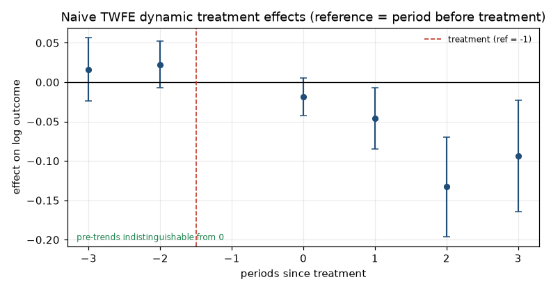
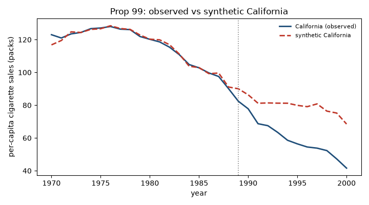

# Observational causal inference: two designs, and where each one breaks

Two policy questions with no randomised trial behind them, estimated from scratch — the
estimators are written in NumPy/SciPy rather than imported, and every headline number is checked
against the published literature in `tests/`.

| | Question | Design | Why naive analysis fails |
|---|---|---|---|
| **A** | Does raising the minimum wage cut teen employment? | Difference-in-differences, staggered adoption, 500 counties × 2003-07 | Many treated units, three cohorts of very different size → pooled two-way FE averages in *already-treated* comparisons |
| **B** | Did California's Proposition 99 (1989, +25¢ excise) cut cigarette sales? | Synthetic control, 39 states × 1970-2000 | Exactly one treated unit → there is no control group to difference against, it has to be constructed |

These are deliberately opposite failure modes, not two flavours of the same thing.

## Results

**A — minimum wage, outcome is log teen employment (`lemp`)**

| Estimator | Estimate | 95% CI | Notes |
|---|---|---|---|
| Naive static two-way FE | −0.0365 | [−0.066, −0.008] | county-clustered SE 0.0148 — **attenuated, and I show why** |
| Event study (dynamic) | −0.019 / −0.046 / −0.133 / −0.094 at τ = 0…3 | — | pre-trend joint Wald p = 0.31; post p = 0.0007 |
| Callaway–Sant'Anna, doubly robust | **−0.0413** | [−0.060, −0.023] | 200-draw unit bootstrap, SE 0.0096 |
| C–S simple / reg / IPW | −0.0398 / −0.0414 / −0.0427 | — | four reweighting strategies agree within 0.003 |
| Sun–Abraham interaction-weighted | −0.040 | — | never-treated control, cohort-share weights |

Reference: published reanalyses of this county panel put the teen-employment effect at roughly
**−4%**. Reproduced ✓. All eight control-rule × estimator combinations span 0.0054 log points —
less than the SE of a single ATT(g,t) cell.

**B — Proposition 99, outcome is per-capita cigarette sales in packs**

| Specification / test | Result | Notes |
|---|---|---|
| California before/after only | −55.9 packs | wrong: absorbs the pre-existing downward trend |
| Two-way FE, all 38 controls | −27.35 (SE 2.85) | right answer for the wrong reason — no state is a valid control |
| Synthetic control, trajectory-matched | **−26.90 in 2000**, −19.75/yr mean, −237 cumulative | pre-period RMSPE 1.70 packs ≈ 1.5% of California's mean |
| Same, three feature-window specs | −21.2 to −24.7 | direction holds, magnitude spreads 4.9 packs |
| In-space placebo, all donors | p = 0.053 | 2 of 38; floor is 1/38 = 0.026 |
| In-space placebo, donors fitting ≥ as well | **p = 0.167** | 2 of 12 — the defensible number, and it is *not* significant |
| In-time placebo (sample truncated 1988) | −4.3 packs/yr manufactured from nothing | ~a fifth of the headline: real pre-existing drift |
| Leave-one-donor-out | −27.93 … −24.85 | dropping Montana or Utah moves it ~8% |

Reference: Abadie, Diamond & Hainmueller (2010) report California's 2000 consumption about **26
packs per capita below its synthetic counterpart**. Reproduced ✓.

## Figures



*Dynamic treatment effects, reference period τ = −1. The three pre-treatment coefficients hug zero
— that is the parallel-trends test — and the effect builds over two years instead of appearing at
once.*



*Synthetic California (dashed) tracks the real one (solid) until 1989, then diverges. The weights
that produce it concentrate on Utah, Montana and Nevada: an effective donor count of 3.8, not 38.*

## Identifying assumptions, and what is actually tested

| Assumption | How it is probed here | Verdict |
|---|---|---|
| **Common trends** (A) | event-study pre-period coefficients + joint Wald; five C–S pre-treatment placebo cells | passes, weakly: p = 0.31, max \|t\| = 1.6, power bounded by 191 treated counties |
| **No anticipation** (A) | treatment starts in the year of the wage change; τ = 0 is already negative and small | consistent with the data, not verifiable from it |
| **Convex-hull coverage** (B) | pre-period RMSPE, plus in-time placebos that quantify how much divergence exists with no treatment | good fit (1.70 packs) *and* real drift (−4.3/yr) — both reported |
| **SUTVA / no spillovers** (A and B) | not tested | **untestable with this data** — cross-county and cross-border flows would need a spatial design |
| **No simultaneous shocks** (B) | `retprice`/`lnprice` enters the matching features | partly absorbed; federal changes and 1990s litigation are not |

## Honest limitations

- **The synthetic control's inference is weak.** Against all 38 donors p = 0.053; restricted to the
  12 that fit at least as well as California it is 0.167. Anyone quoting Prop 99 should quote the
  sign and the order of magnitude, not a p-value.
- **The counterfactual depends on about half a dozen states**, not 38. Effective donor count 3.8;
  top three carry 84% of the weight. Leave-one-out is only informative for those six — the other
  32 deletions are inert because those donors carry ~0 weight.
- **The donor pool is taken as shipped.** `smoking.csv` has 39 states, not 40 — New York is absent —
  and I did not reconstruct Abadie et al.'s pool from the original paper. Donor-pool choice is a
  real degree of freedom here, and the leave-one-donor-out test is the only probe of it.
- **The pre-trend test is a failure to refute, not a confirmation.** No power calculation is
  provided; "how large a violation would this design detect" is unanswered.
- **C–S aggregation treats ATT(g,t) cells as independent** when computing SEs, so the overall
  interval is optimistic; counties contribute to several cells.
- **One covariate (`lpop`)** for the adjustment estimators. With 309 never-treated counties the
  propensity and outcome models have almost nothing to disagree about — that is a property of this
  panel, not a general guarantee.

## Repo map

```
data/raw/            mpdta.csv, smoking.csv/.dta + PROVENANCE.md (sources, checksums, structure)
src/cid/
  io.py              loaders; both panels validated as balanced grids on load
  linreg.py          OLS with cluster-robust SEs and pivoted-QR rank-deficiency handling
  did/twfe.py        naive static TWFE + dynamic event study with joint pre-trend Wald
  did/cs.py          Callaway-Sant'Anna ATT(g,t): simple / reg / IPW / doubly robust
  did/sunabraham.py  Sun-Abraham interaction-weighted event path
  did/diagnostics.py Goodman-Bacon-style 2x2 pairs, forbidden-comparison flags, pre-trend cells
  sc/weights.py      simplex-constrained synthetic control: feature-window and trajectory matching
  sc/placebo.py      in-space permutation p-values, in-time falsification, effective donor count
  viz.py             the six figures under report/figures/
notebooks/           four executed .ipynb files — outputs and figures committed inside them
tests/               52 tests; asserts published values are reproduced, not just that code runs
report/              figures + MEMO.md (one page, non-technical)
app/                 Streamlit explorer: dataset + estimator → ATT, CI, event path / gap curve
```

## Reading order

1. `notebooks/01_design.ipynb` — estimands, assumptions, integrity checks, the panels' structure.
2. `notebooks/02_did_naive_vs_staggered.ipynb` — the same question four ways, and the
   forbidden-comparison table that explains the naive answer.
3. `notebooks/03_synthetic_control_prop99.ipynb` — weight selection on pre-fit, placebo tests, and
   what is defensible to report.
4. `notebooks/04_sensitivity_and_writeup.ipynb` — specification curves, leave-one-donor-out, the
   assumptions no reweighting can fix.
5. `report/MEMO.md` — the decision memo both analyses feed into.

## Quickstart

```bash
make install       # pip install -r requirements.txt
make check-data    # both panels as the balanced grids the estimators assume
make test-fast     # ~20 s, skips the 39-donor placebo refits
make test          # full suite, ~25 s
make notebooks     # re-execute all four .ipynb in place, committing fresh outputs
make app           # Streamlit explorer on localhost:8501
```

Python ≥ 3.11. CI runs the suite on 3.11 and 3.12
([`.github/workflows/tests.yml`](.github/workflows/tests.yml)). No statsmodels, no pyfixest, no R
wrapper — `scipy.linalg.qr` and `scipy.optimize.minimize` are the only non-NumPy dependencies.

## Reproducibility

Bootstrap draws come from seeded generators (`np.random.default_rng`, seeds fixed in module), the
weight program is a deterministic convex solve, and both panels are committed. Re-running
`make notebooks` reproduces every number in this README and in the memo. `tests/` pins the
published reference values within tolerances, so a silent regression in an estimator shows up as a
failing test rather than a changed headline.

## Sources

- Callaway and Sant'Anna (2021), *Difference-in-Differences with Multiple Time Periods*, JoE.
- Sun and Abraham (2021), *Estimating Dynamic Treatment Effects in Event Studies with Heterogeneous
  Treatment Effects*, JoE.
- Abadie, Diamond and Hainmueller (2010), *Synthetic Control Methods for Comparative Case Studies*,
  JASA. Prop 99 application.
- Goodman-Bacon (2021), *Difference-in-Differences with Variation in Treatment Timing*, JoE.
- Data: `d2cml-ai/csdid` (mpdta) and `scunning1975/mixtape` (smoking); see
  [`data/raw/PROVENANCE.md`](data/raw/PROVENANCE.md).
